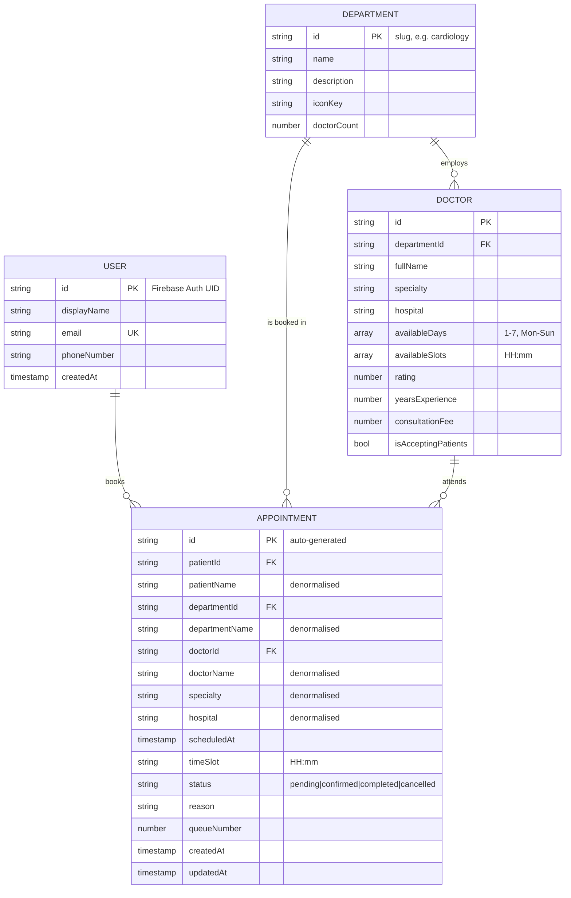

# KIVU — Database Design & ERD

**Module:** Appointment booking · **Owner:** Kethia
**Backend:** Cloud Firestore (NoSQL, document store) · project `kivu-haqms`

---

## 1. Purpose

KIVU lets a patient book a slot with a doctor in a hospital department and
follow that booking through to completion. The data model has to answer four
questions cheaply, because each one is a screen in the app:

| Question | Screen |
|----------|--------|
| Which departments can I book into? | Booking, step 1 |
| Which doctors work in this department? | Booking, step 2 |
| Which times is this doctor still free on this date? | Booking, steps 3–4 |
| What are my appointments and what state is each in? | Schedule |

---

## 2. Entity Relationship Diagram



### Relationships in words

| Relationship | Cardinality | Reasoning |
|--------------|-------------|-----------|
| User → Appointment | 1 : N | A patient books many appointments over time; each appointment belongs to exactly one patient. |
| Department → Doctor | 1 : N | A doctor is listed under one department in this system. A real hospital may cross-list, which would make this M : N and require a join collection. |
| Doctor → Appointment | 1 : N | A doctor is seen by many patients; an appointment is with one doctor. |
| Department → Appointment | 1 : N | Denormalised from the doctor so the schedule can be filtered by department without a second read. |

`APPOINTMENT` is the junction of `USER` and `DOCTOR` — the many-to-many between
patients and doctors is resolved through it, and it carries its own attributes
(time, status, reason), which is exactly why it is an entity and not a link.

---

## 3. Collection schemas

Firestore is schemaless, so this is the contract the app enforces in the model
classes (`lib/features/*/data/models/`).

### `users/{uid}`
Owned by Duke's auth module. The document id **is** the Firebase Auth UID, so
no separate key is needed.

### `departments/{departmentId}`

| Field | Type | Notes |
|-------|------|-------|
| `name` | string | "Cardiology" |
| `description` | string | Shown under the name |
| `iconKey` | string | Mapped to a Material icon in the UI, so no Flutter types leak into the database |
| `doctorCount` | number | Denormalised counter for the directory |

Document ids are readable slugs (`cardiology`, `pediatrics`) rather than random
strings, so seed data is idempotent and appointments are easy to read by eye.

### `doctors/{doctorId}`

| Field | Type | Notes |
|-------|------|-------|
| `departmentId` | string | FK → `departments` |
| `fullName`, `specialty`, `hospital` | string | |
| `availableDays` | array\<number\> | `1`=Monday … `7`=Sunday, matching `DateTime.weekday` |
| `availableSlots` | array\<string\> | `"08:00"`, `"08:30"` … the doctor's template day |
| `rating`, `yearsExperience`, `consultationFee` | number | |
| `isAcceptingPatients` | bool | Filters the booking list |

Availability is stored as a **template** (which days, which times) rather than
as generated slot documents. Free times are then derived at read time:

```
free slots = availableSlots − slots already booked on that date − times already past today
```

This keeps the database small — a doctor is one document instead of hundreds of
generated slot rows — at the cost of one extra query per date the user taps.

### `appointments/{appointmentId}`

| Field | Type | Notes |
|-------|------|-------|
| `patientId` | string | FK → `users` |
| `patientName` | string | Denormalised |
| `departmentId` / `departmentName` | string | FK + denormalised label |
| `doctorId` / `doctorName` / `specialty` / `hospital` | string | FK + denormalised labels |
| `scheduledAt` | timestamp | Date **and** start time, used for sorting and range queries |
| `timeSlot` | string | `"09:30"` — the label the patient picked |
| `status` | string | `pending` · `confirmed` · `completed` · `cancelled` |
| `reason` | string? | Optional symptoms note |
| `queueNumber` | number? | Filled in by Naillah's queue module on the day |
| `createdAt` / `updatedAt` | timestamp | Audit trail |

---

## 4. Design decisions

**Denormalisation of doctor and department names.**
Firestore has no joins. Storing `doctorName` and `hospital` on the appointment
means the Schedule screen renders from a *single* query instead of N+1 reads.
It also freezes the details as they were on the day of booking, which is the
correct behaviour for a medical record — if a doctor later transfers hospital,
past appointments should still show where the patient actually went. The cost
is that a renamed doctor does not propagate to historic appointments; that is
accepted deliberately.

**Status stored as a name, not an index.**
`status: "confirmed"` rather than `status: 1`. Reordering the
`AppointmentStatus` enum can then never silently corrupt existing documents,
and the data is readable in the Firebase console.

**`scheduledAt` as a single timestamp.**
Storing date and time separately would make "my next appointment" impossible to
sort in one query. `timeSlot` is kept alongside it purely as a display label.

**Cancel rather than delete.**
Cancelling sets `status: cancelled` and leaves the document in place, so the
hospital keeps an audit trail and a cancelled slot becomes bookable again
(cancelled appointments are filtered out of the "taken slots" check).
`deleteAppointment` exists in the repository for a true hard delete, but the UI
does not call it.

**Known limitation — double-booking race.**
`createAppointment` reads the taken slots, then writes. Two patients submitting
the *same* slot within the same second could both pass the check. A production
fix is a transaction over a deterministic lock document
(`slot_locks/{doctorId}_{yyyyMMddHHmm}`), which would add a fifth entity. For
this project the pre-check is documented as best-effort, and the second patient
sees "That slot has just been taken" on their next attempt.

---

## 5. Indexes

Composite indexes required by the queries above (`firestore.indexes.json`):

| Collection | Fields | Used by |
|------------|--------|---------|
| `appointments` | `patientId` ASC, `scheduledAt` DESC | Schedule list |
| `appointments` | `doctorId` ASC, `scheduledAt` ASC | Free-slot lookup |
| `doctors` | `departmentId` ASC, `isAcceptingPatients` ASC | Doctor list per department |

The cancelled-appointment filter is applied **in Dart** rather than as a fourth
`where` clause, which deliberately avoids a wider composite index.

---

## 6. Security rules

Summarised from `firestore.rules`:

- `departments` and `doctors` — any signed-in user may read; nobody may write
  from the client (seeded once, then managed by the hospital).
- `appointments` — a patient may read and write **only** documents where
  `patientId == request.auth.uid`; the `patientId` may never be changed after
  creation.
- Everything else is denied by default.

---

## 7. How the team fed into this

The ERD was drafted from the four screen questions in §1, then reviewed with
the team so each module's needs are represented:

| Member | Input | Effect on the model |
|--------|-------|---------------------|
| Duke (auth) | `users` keyed by Firebase Auth UID | `patientId` is the UID directly — no mapping table |
| Jabes (architecture) | One query per screen, no N+1 | Drove the denormalised name fields |
| Naillah (queue) | Needs a position on the day | `queueNumber` reserved on `appointments` |
| Aderline (QA) | Statuses must be testable and readable | Status stored as a string name, four fixed values |
| Kethia (booking) | Free-slot calculation | Availability stored as a template on the doctor |
